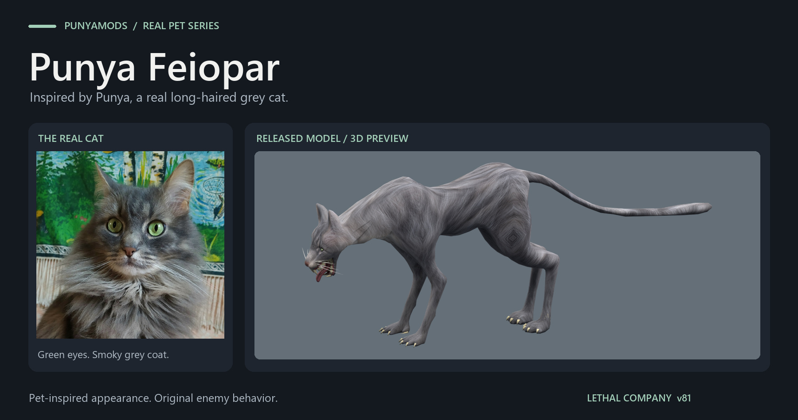
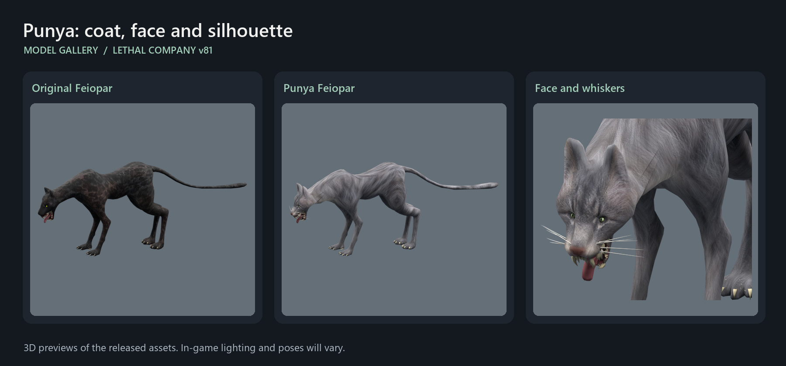

# Punya Feiopar

**A real cat, brought into Lethal Company v81.**

## Meet Punya

Punya is a real long-haired grey cat. His green eyes, pink nose and silver ruff were the starting point for this reskin, with his owner's photographs guiding the coat, face, whiskers and fuller tail.

The result keeps the Feiopar's recognizable body and movement, with a little of Punya's appearance carried into the Company's world.

## See the changes

*These are 3D previews of the released mod assets. Lighting and poses will look different in the game.*

Punya gives the Feiopar a smoky grey coat, a silver ruff, green eyes, white whiskers and a fuller tail. It uses the original Feiopar skeleton, animations, hitboxes and behavior.

## Installation

Install through Thunderstore Mod Manager or r2modman and start the game modded. Each player who wants to see Punya installs the mod on their own client. It requires **Lethal Company v81** and **BepInEx 5**.

The mesh changes are applied to the player's own game assets in memory. If the stock mesh data or rig does not match the supported Steam v81 build, the mod falls back to the texture.

## Configuration

After the first launch, edit `BepInEx/config/local.feioparreskin.cfg`. Set `UsePunyaMesh = false` to use the texture with the original shape. To use a different texture, replace `Feiopar.png` beside the DLL and restart.

## Credits and the real-pet series

Lethal Company and Feiopar by Zeekerss. The new texture and icon were created with **ImageGen**, using photographs of the real Punya as reference. The reference photo on this page is a photograph of Punya; the model previews show the released cosmetic assets.

Also meet [Stitch, the real Jack Russell behind Stitch Eyeless Dog](https://thunderstore.io/c/lethal-company/p/PunyaMods/StitchEyelessDog/).
