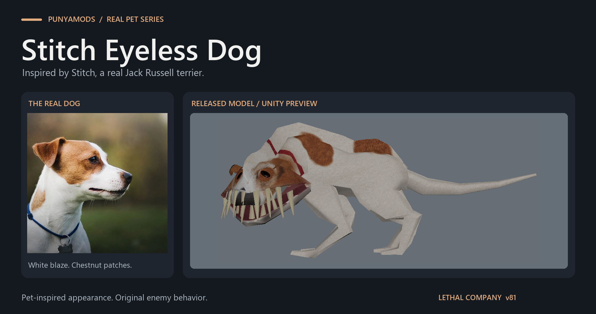
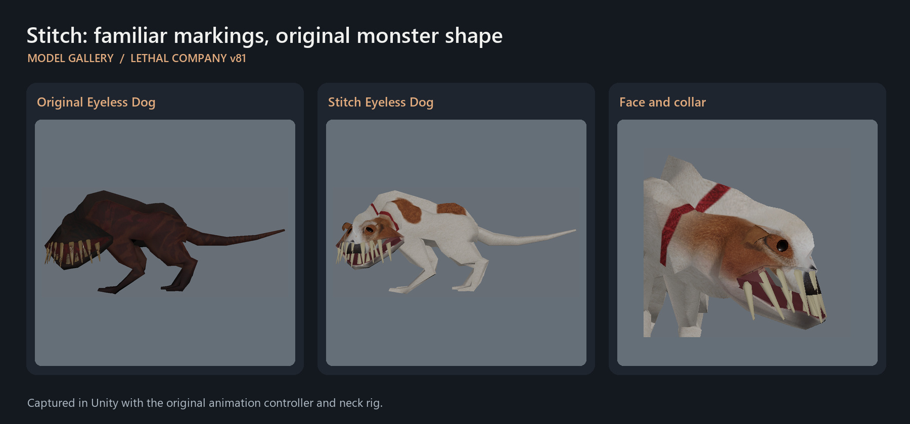

# Stitch Eyeless Dog

**A real dog, brought into Lethal Company v81.**

## Meet Stitch

Stitch is a real brown-and-white Jack Russell terrier. His white facial blaze, chestnut patches, folded ears and collar come from photographs of the real dog, adapted to the Eyeless Dog's exaggerated proportions.

The huge mouth, hunched body, long limbs and tail keep the original monster recognizable. The eyes are decorative: the dog still hears, hunts and attacks exactly as the original Eyeless Dog does.

## See the changes

*These previews were captured in Unity with the original animation controller and evaluated neck rig.*

## Installation

Install with Thunderstore Mod Manager or r2modman and launch the game modded. BepInEx 5 is the only dependency; the manager installs it automatically.

Each player who wants to see Stitch needs the mod on their own client. More Suits, ModelReplacementAPI and Punya Feiopar are not required.

For manual installation, copy the archive's `BepInEx` folder into your BepInEx game or profile directory, merging folders.

## What changes

- New coat and face textures based on the reference dog's markings.
- Small cosmetic ears and thin eye surfaces attached to the original 22-bone rig.
- A subtle nose relief on the original surface, without a separate nose object.
- A red collar painted directly onto the neck, so there is no floating collar mesh.
- Separate texture areas for the outer nose and inner mouth, plus cleaner tooth materials.
- Lighting normals that follow the deformed body, avoiding dark shoulder artifacts.

The original body triangles and skin weights are retained. AI, hearing, damage, speed, spawn rates, hitboxes, audio, animation controller and network messages are unchanged. Both original body LODs are supported. There are no spawn hotkeys or test cameras in this package.

## Configuration

After the first launch, edit `BepInEx/config/local.stitcheyelessdog.cfg`:

| Setting | Default | Effect |
|---|---|---|
| `UseTerrierDetails` | `true` | Adds the small folded ears and eye caps. Disabling it keeps the coat, nose and painted collar. |
| `CorrectSkinnedNormals` | `true` | Updates lighting normals for visible body renderers, at up to 30 updates per second. Disable it if you prefer the original lighting or need to reduce CPU work. |

To change the artwork, replace `Stitch.png` and/or `StitchDetails.png` beside `StitchDog.dll`, preserving the atlas layout, then restart the game. The main atlas is 4096 x 2048; the detail atlas is 1024 x 1024. Keep the accompanying mesh and mask files installed.

## Compatibility and testing

Built and visually checked on the Steam **v81** build. The original animation controller and evaluated neck rig were used for idle, chase and lunge previews, with numerical checks of both body LODs. Other game versions and a multiplayer encounter have not been verified.

Other mods replacing the Eyeless Dog's mesh or material may override this appearance. If required core assets cannot be loaded, the mod leaves the stock dog in place; if the expected bone layout does not match, it uses a texture fallback.

## Credits

Lethal Company and the original Eyeless Dog design by Zeekerss. New texture references, iris albedo and icon were created with **ImageGen** using photographs of Stitch as reference, then adapted to the game's UV layout. The ears and eye surfaces are custom cosmetic additions.

This is a reskin of a real pet, not the blue cartoon character. Reference photographs, game DLLs and authoring tools are not included.

Also meet [Punya, the real grey cat behind Punya Feiopar](https://thunderstore.io/c/lethal-company/p/PunyaMods/PunyaFeiopar/).
